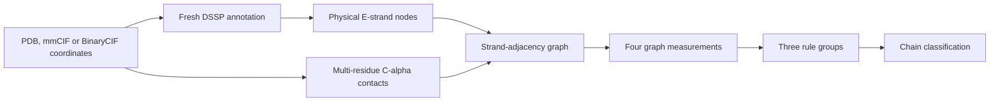

# Cooper-Beta

_Screen protein structures for beta-barrel-like folds with interpretable strand-graph rules._

Cooper-Beta reads PDB, mmCIF, or BinaryCIF structures and classifies each protein chain as `BARREL` or `NON_BARREL`. It uses DSSP to identify beta-strands, connects them in a strand-adjacency graph, and applies three rule groups. You can analyze a single structure or screen a directory from the command line or Python.

The name combines *cooper*, a barrel maker, with *beta*, referring to the beta-sheets that form protein beta-barrels.

**Paper:** [Geometric Intuition Enables Resource-Efficient Screening for β-Barrel-Like Folds in Viral Structural Dark Matter](https://doi.org/10.1002/prot.70192), published in *Proteins: Structure, Function, and Bioinformatics* (2026). See [Citation](#citation) for the recommended reference and BibTeX.

## Quick start

In a Python 3.10+ environment, install DSSP and Cooper-Beta, then check the installation:

```bash
conda install -c conda-forge 'dssp>=4.5.3'
pip install cooper-beta
cooper-beta --check-env
```

Analyze a structure, replacing `path/to/structure.cif` with your input file:

```bash
cooper-beta path/to/structure.cif \
  --workers 1 \
  --prepare-workers 1 \
  --out results.csv
```

`results.csv` contains one row per author chain, identified by the depositor's chain identifier (`auth_asym_id` in mmCIF), with the classification, graph measurements, and decision reason. `results.csv.manifest.json` records the settings and software environment. A failed input is reported as `ERROR`; see [Reading the output](#reading-the-output) for details.

You can also pass a directory to screen multiple structures. To try the bundled structures, see [Run the included examples](#run-the-included-examples).

## Contents

- [Quick start](#quick-start)
- [Installation](#installation)
- [Usage](#usage)
- [Reading the output](#reading-the-output)
- [Algorithm](#algorithm)
- [Configuration](#configuration)
- [Python API](#python-api)
- [Evaluation and experiments](#evaluation-and-experiments)
- [Reproducibility](#reproducibility)
- [Troubleshooting](#troubleshooting)
- [Release notes](#release-notes)
- [Citation](#citation)
- [License](#license)

## Installation

### Requirements

| Requirement | Supported version | Purpose |
| --- | --- | --- |
| Python | 3.10 or newer | Cooper-Beta runtime |
| DSSP | `mkdssp` 4.5.3 or newer | Fresh secondary-structure and ladder annotation |

`cooper-beta --check-env` prints the Python executable, DSSP executable, and DSSP version.

### Optional dependencies and development

Optional dependency groups provide additional workflows:

| Installation | Adds |
| --- | --- |
| `pip install 'cooper-beta[eval]'` | Evaluation tables and metrics |
| `pip install 'cooper-beta[scripts]'` | Dataset, annotation, and plotting utilities |
| `pip install 'cooper-beta[ml]'` | Grouped machine-learning experiments |
| `pip install 'cooper-beta[full]'` | Evaluation, scripts, plotting, and machine learning |

For a source checkout, create the locked development environment with:

```bash
uv tool install 'conda-lock==3.0.4'
bash scripts/setup_env.sh --name cooperbeta --dev
```

## Usage

### Run the included examples

The repository includes two predicted structures as positive examples. The default rules classify author chain `A` in both files as `BARREL`. Clone the repository and run from its root to use the `examples/` directory:

```bash
git clone https://github.com/GeraltZeroZhong/Cooper-Beta.git
cd Cooper-Beta
cooper-beta examples \
  --workers 1 \
  --prepare-workers 1 \
  --out example_results.csv
```

| Example | Expected graph measurements | Expected class |
| --- | --- | --- |
| [`M4QT10.cif`](examples/M4QT10.cif) | 8 strands, 8 adjacencies, 8 cycle-supported strands, cycle rank 1 | `BARREL`, chain `A` |
| [`A0A2R4ALS6.cif`](examples/A0A2R4ALS6.cif) | 9 strands, 9 adjacencies, 8 cycle-supported strands, cycle rank 1 | `BARREL`, chain `A` |

[`examples/manifest.json`](examples/manifest.json) records the source, target chain, scientific label, sequence length, global pLDDT, and licence for each structure.

### Analyze one file or a directory

```bash
cooper-beta path/to/structures \
  --workers 8 \
  --prepare-workers 4 \
  --out results.csv
```

Directory discovery is recursive. Supported suffixes are `.pdb`, `.ent`, `.cif`, `.mmcif`, and `.bcif`, including their `.gz` variants. BinaryCIF is decoded to temporary mmCIF with its original categories, chains, residue identifiers, and model numbers preserved. The CLI writes:

- `results.csv`: one row per analyzed author chain
- `results.csv.manifest.json`: resolved settings, inputs, software environment, execution details, and output state

An existing output path is preserved by default. Select a new path or explicitly replace the existing result:

```bash
cooper-beta path/to/structures \
  --out results.csv \
  output.existing_artifact_policy=replace
```

## Reading the output

The `BARREL` class describes closure in the strand-adjacency graph.

### Result classes

| `result` | Interpretation |
| --- | --- |
| `BARREL` | All three strand-graph rule groups passed |
| `NON_BARREL` | At least one rule condition failed |
| `ERROR` | Structure preparation or worker execution failed for the reported file or chain |

The `reason` field summarizes passed rules or identifies unmet thresholds. `error_code` identifies failures such as structure parsing or DSSP execution. `result_stage` identifies the processing stage: `preparation`, `decision`, or `worker`.

The detection CLI exits with status `2` if any result row is `ERROR`, including batches with successful results. It writes the complete results CSV and, when enabled, the run manifest before exiting. A completed run containing only `BARREL` and `NON_BARREL` results exits with status `0`.

### Fixed CSV schema

The result CSV contains 14 columns in this order:

```text
filename,source_path,author_chain_id,result,result_stage,
dssp_unassigned_residue_count,strand_count,strand_adjacency_count,
cycle_strand_count,cycle_strand_fraction,cycle_rank,reason,error_code,degraded
```

| Field | Definition |
| --- | --- |
| `filename` | Input filename |
| `source_path` | Resolved input path used by the run |
| `author_chain_id` | Author-chain identifier from the selected model |
| `dssp_unassigned_residue_count` | Included polymer residues with valid C-alpha coordinates and missing or non-finite N, C, or O coordinates |
| `strand_count` | Number of physical DSSP `E` strands after beta-bulge merging |
| `strand_adjacency_count` | Number of undirected ladder- or contact-supported graph edges |
| `cycle_strand_count` | Strand count in the largest connected component formed by edges that participate in cycles |
| `cycle_strand_fraction` | `cycle_strand_count / strand_count`, or `0` for an empty graph |
| `cycle_rank` | Number of independent graph cycles |
| `degraded` | Indicates an error row produced under degraded preparation policy |

All counts are non-negative integers. `cycle_strand_fraction` ranges from `0` to `1`.

## Algorithm

### Processing flow



### Structure preparation

The unit of classification is one author chain in the selected coordinate model. Cooper-Beta retains author-chain identifiers, residue numbers, insertion codes, alternate locations, and declared polymer positions. In mmCIF, `label_seq_id` maps atom records to positions in the declared polymer sequence. When PDB `SEQRES` is available, positions are assigned by a unique alignment to that sequence. Coordinate-only PDB files use observed residue order. Sequence-based comparison methods use the complete declared sequence, which can include residues absent from the coordinates.

For coordinate-only mmCIF files, Cooper-Beta processes each author chain independently. Amino acids in `ATOM` records form the initial polymer. A modified amino acid in a `HETATM` record joins the polymer when it has N, CA, C, and O backbone atoms and a peptide bond to an included neighbor. The default maximum C-N distance is 1.8 Å. Temporary polymer categories allow DSSP to process single-chain and multichain coordinate exports.

Cooper-Beta regenerates DSSP annotations for the selected model and converts DSSP `E` ranges into beta-strand segments.[^1] Segments covered by the same side of a DSSP ladder are merged into one physical strand, preserving beta-bulges within a single node. Residues with valid C-alpha coordinates and missing or non-finite N, C, or O coordinates remain in the polymer record, receive `dssp_assignment_available=false`, and contribute to `dssp_unassigned_residue_count`.

### Strand-adjacency graph

For an author chain, let the undirected graph be $G=(V,E)$, where each node in $V$ is one physical strand. An edge is supported by either:

1. a DSSP ladder connecting two strands; or
2. at least two C-alpha contact pairs separated by at most 6.8 Å, with at least two distinct contacting residues on each strand.

The graph is deterministic for a fixed coordinate model, DSSP release, and resolved configuration. The contact distance and support counts are configurable under `strand_adjacency`.

### Graph measurements

Tarjan low-link traversal identifies bridge edges. Removing those bridges leaves the edges that participate in at least one cycle. Cooper-Beta reports:

1. **Strand adjacency count:** the number of undirected edges in the graph.
2. **Cycle strand count and fraction:** the number of strands in the largest connected component formed by non-bridge edges, reported together with its fraction of all graph strands. An empty graph has a fraction of zero.
3. **Cycle rank:** the number of independent cycles, calculated from the graph's edge, node, and connected-component counts.

The depth-first bridge traversal visits each graph node and edge a constant number of times.

### Direct classification

The default classifier applies three rule groups with inclusive thresholds:

| Rule group | Default condition |
| --- | ---: |
| `strand_adjacency_count` | $A \ge 8$ |
| `cycle_strand_count / cycle_strand_fraction` | $S \ge 4$ and $F \ge 0.05$ |
| `cycle_rank` | $R \ge 1$ |

The decision is

$$
\texttt{BARREL} = (A\ge 8) \land (S\ge 4) \land (F\ge 0.05) \land (R\ge 1).
$$

A chain receives `NON_BARREL` when this conjunction is false. The four measurements remain available as continuous or count-valued features for learned classifiers.

## Configuration

Configuration fields are defined in [`config.py`](src/cooper_beta/config.py), with defaults in [`config.yaml`](src/cooper_beta/conf/config.yaml). Command-line overrides use Hydra dot notation.

### Scientific defaults

| Setting | Default | Unit or meaning |
| --- | ---: | --- |
| `strand_adjacency.maximum_ca_distance_angstrom` | `6.8` | Å |
| `strand_adjacency.minimum_contact_pair_count` | `2` | C-alpha pairs |
| `strand_adjacency.minimum_contact_residue_count_per_strand` | `2` | Distinct residues per strand |
| `rules.strand_adjacency_count.minimum` | `8` | Graph edges |
| `rules.cycle_strand_count_fraction.minimum_count` | `4` | Cycle-supported strands |
| `rules.cycle_strand_count_fraction.minimum_fraction` | `0.05` | Fraction of graph strands |
| `rules.cycle_rank.minimum` | `1` | Independent cycles |

Override values directly on the command line:

```bash
cooper-beta path/to/structures \
  --out results.csv \
  runtime.native_threads_per_process=1 \
  strand_adjacency.maximum_ca_distance_angstrom=6.8 \
  rules.strand_adjacency_count.minimum=8 \
  rules.cycle_strand_count_fraction.minimum_count=4 \
  rules.cycle_strand_count_fraction.minimum_fraction=0.05 \
  rules.cycle_rank.minimum=1
```

Python mappings use the same keys:

```python
from cooper_beta import build_config

config = build_config(
    {
        "runtime.workers": 8,
        "runtime.prepare_workers": 4,
        "rules.cycle_rank.minimum": 1,
    }
)
```

Run `cooper-beta --help` for command-line options, defaults, output files, and exit codes.

## Python API

`detect` returns a typed `PipelineRunResult`. A CSV is written when `output` is supplied or `write_csv=True` is selected.

```python
from cooper_beta import detect

run = detect(
    "path/to/structures",
    workers=4,
    prepare_workers=2,
    output="results.csv",
)

print(run.result_counts)
for row in run.rows:
    print(
        row.filename,
        row.author_chain_id,
        row.result,
        row.strand_adjacency_count,
        row.cycle_strand_count,
        row.cycle_strand_fraction,
        row.cycle_rank,
    )
```

| Interface | Purpose |
| --- | --- |
| `detect(...)` | Run end-to-end chain classification |
| `build_config(...)` | Build and validate typed settings |
| `PipelineRunResult` | Access rows, inputs, output path, settings, and class counts |
| `DetectionResult` | Access one 14-column chain result |
| `ProteinLoader` | Parse structures and obtain per-chain preparation results |
| `StrandAdjacencyGraph` | Represent an immutable author-chain graph |
| `StrandGraphMeasurements` | Store the four measured graph values |

Exceptions derive from `CooperBetaError`. Subclasses identify invalid configuration, unusable inputs, structure parsing errors, DSSP availability or execution errors, missing chains, changed inputs, and failures while writing output files.

## Evaluation and experiments

### Direct-classifier evaluation

Install the evaluation extra and provide separate positive and negative structure collections:

```bash
cooper-beta-eval \
  --positives path/to/positive_structures \
  --negatives path/to/negative_structures \
  --positive-manifest path/to/positive_truth.csv \
  --negative-manifest path/to/negative_truth.csv \
  --metric-level both \
  --metric-error-policy strict \
  --save-dir evaluation-results
```

Each target-chain manifest has four columns:

```text
filename,source_path,structure_sha256,target_author_chain_id
```

The evaluator reports target-chain metrics and file-level metrics separately. A file is classified as positive when at least one chain is positive. Metrics with an undefined denominator are stored as null values with an accompanying `*_defined` field.

### Learned classifier and robustness analyses

[`scripts/nested_grouped_decision_experiment.py`](scripts/nested_grouped_decision_experiment.py) evaluates learned models from four features:

```text
strand_adjacency_count,cycle_strand_count,cycle_strand_fraction,cycle_rank
```

Family groups remain intact across cross-validation folds. [`scripts/perturbation_eval.py`](scripts/perturbation_eval.py) evaluates sensitivity to controlled coordinate noise. [`scripts/annotate_bfvd_candidates_blastp.py`](scripts/annotate_bfvd_candidates_blastp.py) supports sequence annotation of screened candidates.

Adapters for Foldseek, IsItABarrel, and PRED-TMBB2 are documented under [`external_methods`](external_methods). Their standardized output tables use author-chain identifiers for comparison with Cooper-Beta results.

## Reproducibility

Cooper-Beta records the resolved configuration, input files, package version, DSSP executable and version, execution settings, and output status in the run manifest. Input and output ordering are deterministic. Cached structure preparation results are reused when the inputs, software, and preparation settings match.

Dependency versions are recorded in:

- `uv.lock` for Python package resolution
- `environment.yml` and `conda-lock.yml` for Python plus DSSP

For comparative studies, define target chains and family groups before fitting models, retain complete held-out predictions, and report the Cooper-Beta version, DSSP version, resolved settings, grouping strategy, and metric policy. Dataset-construction scripts are available under [`data/scripts`](data/scripts).

## Troubleshooting

| Symptom | Likely cause | Action |
| --- | --- | --- |
| `DSSP: not found` | DSSP is absent from `PATH` | Install `dssp>=4.5.3` or set `runtime.dssp_bin_path=/path/to/mkdssp` |
| `Unsupported DSSP version` | The resolved DSSP predates 4.5.3 | Update DSSP and rerun `cooper-beta --check-env` |
| `OUTPUT_ARTIFACT_EXISTS` | The output CSV or manifest already exists | Choose a new `--out` path or set `output.existing_artifact_policy=replace` |
| `STRUCTURE_PARSE_FAILED` | The structure or declared polymer mapping is incomplete or ambiguous | Validate the selected model, author chains, `SEQRES`, and mmCIF polymer categories |
| `DSSP_FAILED` | DSSP could not annotate the prepared coordinate model | Inspect the reported DSSP message and validate the selected model with DSSP 4.5.3 or newer |
| Expected chain is absent | Label and author-chain identifiers differ | Inspect the structure's author-chain identifiers and the `author_chain_id` column |
| A large run uses too many processes | Worker counts exceed the desired resource allocation | Set `--workers`, `--prepare-workers`, and `runtime.native_threads_per_process` explicitly |

For a minimal diagnostic, run one structure with one worker and preserve the error message:

```bash
cooper-beta path/to/structure.cif \
  --workers 1 \
  --prepare-workers 1 \
  --out diagnostic.csv
```

## Release notes

### 1.0.1

- Adds BinaryCIF (`.bcif`, `.bcif.gz`) through the RCSB `mmcif` reader, preserving polymer declarations and atom identities
- Includes `.ent` and `.ent.gz` in default input discovery
- Supports coordinate-only PDB without `SEQRES` and multichain coordinate-only mmCIF
- Includes the configured peptide-bond distance in preparation-cache reuse decisions
- Returns exit status `2` when a detection batch contains any `ERROR` row, preserving the complete results CSV and run manifest

### 1.0.0

Initial public release.

- Builds physical strands from fresh DSSP `E` ranges and merges beta-bulge fragments assigned to one ladder side
- Combines DSSP ladder adjacencies with multi-residue C-alpha contacts
- Measures `strand_adjacency_count`, `cycle_strand_count`, `cycle_strand_fraction`, and `cycle_rank`
- Applies three configurable direct-classifier rule groups
- Produces a fixed 14-column chain result and a run manifest linked to its output file
- Supports PDB, mmCIF, and configured gzip-compressed inputs
- Provides typed configuration, grouped evaluation tools, locked environments, and two curated positive examples

## Citation

If you use Cooper-Beta in your research, please cite:

> Zhong, S., & Jiang, Y. (2026). Geometric Intuition Enables Resource-Efficient Screening for β-Barrel-Like Folds in Viral Structural Dark Matter. *Proteins: Structure, Function, and Bioinformatics*. [https://doi.org/10.1002/prot.70192](https://doi.org/10.1002/prot.70192)

```bibtex
@article{Zhong2026CooperBeta,
  author  = {Zhong, Shuyu and Jiang, Yuying},
  title   = {Geometric Intuition Enables Resource-Efficient Screening for {$\beta$}-Barrel-Like Folds in Viral Structural Dark Matter},
  journal = {Proteins: Structure, Function, and Bioinformatics},
  year    = {2026},
  doi     = {10.1002/prot.70192},
  url     = {https://doi.org/10.1002/prot.70192}
}
```

The repository also provides [`CITATION.cff`](CITATION.cff) for GitHub's **Cite this repository** feature, with the paper as the preferred citation.

## License

Cooper-Beta source code is released under the [MIT License](LICENSE). The files in `examples/` retain the [CC BY 4.0](https://creativecommons.org/licenses/by/4.0/) licence recorded in [`examples/manifest.json`](examples/manifest.json).

## References

[^1]: Hekkelman, M. L. et al. (2025). "DSSP 4: FAIR annotation of protein secondary structure." _Protein Science_, 34(8), e70208. https://doi.org/10.1002/pro.70208
